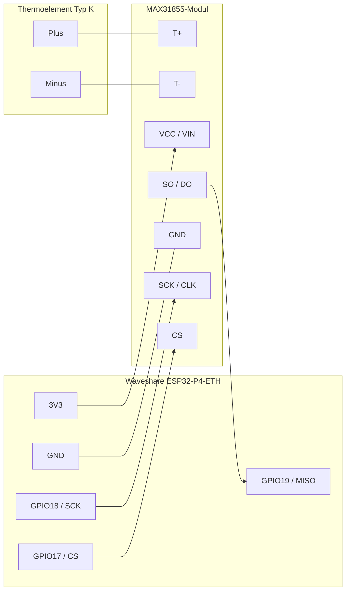

# ESP32-P4-ETH Thermoelement

MicroPython-Anwendung fuer das Waveshare ESP32-P4-ETH mit MAX31855,
Ethernet-Konfigurationsseite und MQTT-Temperaturversand.

## Auf das Board uebertragen

1. `main.py`, `config_web.py` und `max31855.py` in das Hauptverzeichnis des
   MicroPython-Dateisystems uebertragen, beispielsweise mit Thonny oder mpremote.
   `test_config_web.py` wird nur fuer lokale Tests benoetigt.
2. Fuer MQTT die aktuelle Bibliothek `umqtt.simple` installieren. Beispielsweise
   auf dem PC mit installiertem mpremote: `mpremote mip install umqtt.simple`.
   Das Board benoetigt dazu eine funktionierende Internetverbindung. Alternativ
   die Bibliothek vom PC als `lib/umqtt/simple.py` uebertragen. Benoetigt wird die
   aktuelle Variante mit `MQTTClient.connect(timeout=...)`.
3. Ethernet an ein Netz mit DHCP anschliessen, USB-Konsole oeffnen und das Board
   neu starten. Ohne Konfigurationsdatei startet das Geraet mit DHCP und ohne MQTT.
4. Die USB-Konsole zeigt die URL `http://<IP-Adresse>/`. Die IP ist auch in der
   DHCP-Lease-Liste des Routers sichtbar. Ein Web-Login ist nicht erforderlich.
5. Die URL im Browser oeffnen und Ethernet-/MQTT-Einstellungen bearbeiten.
   **Speichern und neu starten** schreibt `config.json` und startet nach etwa drei
   Sekunden neu. Danach gegebenenfalls die neue IP aufrufen.

## Einstellungen

- Ethernet: DHCP oder statische IPv4-Adresse, Subnetzmaske, Gateway und DNS.
  Die statischen Felder werden nur im statischen Modus angewendet.
  Die vorgeschlagenen Adressen unbedingt an das eigene Netz anpassen und eine
  freie IP ausserhalb des DHCP-Pools bzw. eine reservierte IP verwenden.
  Gateway `0.0.0.0` ist fuer ein isoliertes Subnetz moeglich.
- MQTT: Schalter **Ein/Aus** sowie Broker als IPv4-/DNS-Name ohne URL-Schema,
  Port, Topic, Benutzername, Passwort und Sendeintervall von 1 bis 65535 Sekunden.
  **Aus** deaktiviert MQTT, behaelt aber die Broker-Einstellungen. Alte
  Konfigurationen ohne Schalter uebernehmen den bisherigen Zustand anhand des
  Broker-Felds. Ein leeres Passwort-Feld behaelt das gespeicherte Passwort;
  zum Entfernen die Auswahl **Gespeichertes Passwort > Loeschen** verwenden.
- MQTT-Nachrichten verwenden QoS 0, ohne Retain und eine eindeutige Client-ID je
   Board. Verbindungsversuche erfolgen hoechstens alle 30 Sekunden. Keepalive ist
   deaktiviert, damit auch lange Sendeintervalle moeglich sind.
- Kalibrierung: Im Web-UI lassen sich Profile pro Thermocouple-ID mit 2 bis 10
   Mess-/Referenztemperatur-Paaren anlegen. Zwischen Punkten wird linear
   interpoliert; ausserhalb bleibt der Rohwert unveraendert.
- `config.json` speichert Ethernet- und MQTT-Einstellungen getrennt:

   ```json
   {
      "ip": {
         "dhcp": true,
         "address": "192.168.1.200",
         "netmask": "255.255.255.0",
         "gateway": "192.168.1.1",
         "dns": "192.168.1.1"
      },
      "mqtt": {
         "enabled": false,
         "server": "",
         "port": 1883,
         "topic": "sensor/temperature",
         "user": "",
         "password": "",
         "interval": 5
      }
   }
   ```

   Kalibrierprofile liegen separat in `calibration.json`:

   ```json
   {
      "active_id": "TC-01",
      "profiles": {
         "TC-01": {
            "points": [
               {"measured": 0.0, "reference": 0.5},
               {"measured": 100.0, "reference": 99.5}
            ]
         }
      }
   }
   ```

   Alte flache Netzwerkeinstellungen werden beim Laden uebernommen und beim
   naechsten Speichern gruppiert geschrieben. Bereits in `config.json` gespeicherte
   Kalibrierprofile werden beim Start nach `calibration.json` migriert.
- Die Startseite zeigt MAC-Adresse, IP-Adresse, optionalen MQTT-Status,
  Sensor-ID, Sensor-Status und Temperatur in dieser Reihenfolge. Der Status
  **Calibrated** erscheint nur, wenn die Korrektur den Temperaturwert verändert.
   Status und Temperatur werden sekündlich aktualisiert. MQTT, `GET /api/temperature`
   und `GET /api/status` liefern dasselbe JSON mit kalibrierter und roher Temperatur:
   `{"temperature":24.5,"unit":"\u00b0C","sensor":"OK","sensor_id":"TC-02","calibrated":true,"raw_temperature":25.0}`.
- Calibration API: `GET /api/calibration` returns all profiles and the active ID.
   `POST /api/calibration` accepts JSON to create/update and activate a profile:

   ```json
   {"sensor_id":"TC-02","points":[{"measured":0.0,"reference":0.5},{"measured":100.0,"reference":99.5}]}
   ```

   Send `{"sensor_id":"TC-01"}` to activate an existing profile without
   changing its points. Unrelated profiles are retained. The API has no login;
   use it only on a trusted local network.

## Hardware und Firmware

Die LAN-Initialisierung orientiert sich am
[Waveshare-Ethernet-Beispiel](https://docs.waveshare.com/ESP32-P4-ETH/ESP-IDF):
IP101, PHY-Adresse 1, MDC GPIO31, MDIO GPIO52, PHY-Reset GPIO51 und externer
RMII-Takt an GPIO50. GPIO51 ist ein **Reset**, kein PHY-Power-Pin.
Die weiteren RMII-Pins kommen aus den ESP32-P4-Standardeinstellungen der Firmware.

Die installierte Firmware muss `network.LAN`, `network.PHY_IP101`, die Argumente
`reset`, `ref_clk`, `ref_clk_mode`, `LAN.ipconfig(dhcp4=True)` und `asyncio`
unterstuetzen. Die IP-Konfiguration erfolgt bei deaktiviertem LAN, bevor Ethernet
aktiviert wird. Damit konkurriert der manuelle DHCP-Start nicht mit dem
automatischen Start durch Ethernet-Link-Ereignisse. Die USB-Konsole zeigt dafuer
`Ethernet: IP-Konfiguration vor LAN-Aktivierung.` an. Dass MicroPython
startet, garantiert diese Ethernet-Unterstuetzung nicht. Bei LAN-Fehlern zuerst
Firmware-Version, Boardrevision und Pinbelegung mit dem
[Schaltplan](https://files.waveshare.com/wiki/ESP32-P4-ETH/ESP32-P4-ETH-datasheet.pdf)
abgleichen. Die konkrete Firmware und Hardware wurden hier nicht getestet.

Die Sensor-Pins sind SCK GPIO18, MISO GPIO19 und CS GPIO17. Diese Pins sind laut
Board-Pinout am Header herausgefuehrt. MOSI ist explizit auf GPIO16 gesetzt und
wird am MAX31855 nicht angeschlossen; GPIO16 deshalb nicht anderweitig verwenden.
Die bisherigen GPIO10 bis GPIO13 sind am gezeigten Header nicht herausgefuehrt.
Die Belegung kann oben in `main.py` geaendert werden. Gemeinsame Masse und
3,3-V-kompatible Versorgung/Logik verwenden. Ohne initialisierbaren Sensor bleibt
die Webkonfiguration trotzdem verfuegbar.

### MAX31855 anschliessen

<!-- Generated by GitHub Copilot - Oct-24-2026 -->


   | ESP32-P4-ETH Header | MAX31855-Modul |
   | --- | --- |
   | 3V3 | VCC / VIN, sofern fuer 3,3 V geeignet |
   | GND | GND |
   | GPIO18 | SCK / CLK |
   | GPIO19 | SO / DO |
   | GPIO17 | CS |

   Auf dem gezeigten Pinout liegen GPIO19, GPIO18 und GPIO17 im oberen Bereich der
   linken Stiftleiste, wenn USB oben und RJ45 unten ist. Der 3V3-Pin liegt rechts
   unter EN. Einen GND-Pin der seitlichen Stiftleisten verwenden, nicht die gelben
   RJ-/PoE-Anschluesse unten.

- Vor dem Verdrahten USB und PoE abziehen.
- Versorgung und Logik muessen 3,3-V-kompatibel sein. Bei einem Modul mit `VIN`
   dessen Versorgungsspezifikation pruefen.
- MOSI wird am MAX31855 nicht angeschlossen; das Modul liefert nur Daten.
- GPIO-Nummern sind keine physischen Steckplatznummern. Beschriftung und Pinout
   des Waveshare-Headers pruefen.
- Das Thermoelement gehoert an `T+` und `T-`, nicht an die Versorgung.

## Wiederherstellung

Bei einer falschen statischen IP ueber USB die Anwendung mit Strg+C anhalten und
in der MicroPython-Konsole ausfuehren:

```python
import os
import machine
os.remove("config.json")
machine.reset()
```

Dadurch werden saemtliche gespeicherten Einstellungen inklusive MQTT-Zugangsdaten
geloescht. Der naechste Start nutzt DHCP. Eine fehlende oder beschaedigte Datei
fuehrt ebenfalls zu DHCP. Ohne DHCP-Server die passende statische Konfiguration
vorab ueber USB mit `config_web.save_config(...)` schreiben; ein WLAN-Access-Point
ist auf diesem Board nicht vorgesehen.

## Sicherheit und Grenzen

Nur in einem vertrauenswuerdigen, isolierten LAN verwenden. **Es gibt keinen
Web-Passwortschutz: Jeder mit Netzwerkzugriff kann die Einstellungen lesen und
aendern sowie die Temperatur abrufen.** Keine Portfreigabe ins Internet einrichten.
HTTP und MQTT sind hier **nicht TLS-verschluesselt**;
Broker-Zugangsdaten koennen im Netz mitgelesen werden. Port 8883 allein
aktiviert kein MQTT-TLS. Fuer nicht vertrauenswuerdige Netze sind zusaetzliche
TLS-Konfiguration mit Zertifikatspruefung und abgesicherter Zugriff notwendig.
Das MQTT-Passwort liegt im Klartext im Board-Dateisystem, wird aber nie an den
Browser zurueckgesendet. Physischer/USB-Zugriff erlaubt das Auslesen.

Aenderungen erfordern POST und ein zufaelliges CSRF-Token. Das Token wird beim
Oeffnen der Seite automatisch ins Formular eingesetzt und erfordert keine
Benutzereingabe. Es verhindert fremde Formularanfragen, ersetzt aber keinen Login.
Anfragen sind auf je 4 KiB Header und Body sowie fuenf Sekunden begrenzt.
Es wird nur eine Anfrage gleichzeitig bearbeitet. Dateien werden nur beim
Speichern geschrieben, nicht bei jeder Messung. Die temporaere Datei wird per
Rename ersetzt; dafuer das uebliche MicroPython-LittleFS verwenden.

MQTT verwendet synchrone Bibliotheksaufrufe mit zwei Sekunden Socket-Timeout.
Waehrend eines solchen Aufrufs kann HTTP kurz pausieren; DNS-Aufloesung ist je
nach Firmware nicht durch diesen Timeout begrenzt. Eine Broker-IP vermeidet
DNS-Wartezeiten. Es gibt keine automatische Ruecknahme einer zwar syntaktisch
gueltigen, aber im eigenen Netz nicht erreichbaren statischen IP.

## Lokale Tests

Auf dem PC mit Python 3.8 oder neuer:

```text
python -m unittest -v test_config_web
```

Die Tests pruefen Konfiguration, Dateiersatz, Eingabevalidierung, das Ausblenden
des MQTT-Passworts, loginfreien Zugriff, CSRF, fragmentierte Anfragen und den Neustartauftrag. Sie ersetzen
keinen Test von Ethernet, SPI und MQTT auf dem echten Board.